# AppSec Guru

A self-hosted application-security cockpit around **Tenable Security Center** and
its **WAS (Web Application Scanning)** sensors, with an offensive AI assistant.

> A Tenable Cyber Exchange project. Designed and developed with care by Ali Okan Yüksel.
> If it saves you time: [buy me a coffee](https://buymeacoffee.com/ayuksel).

## Demo

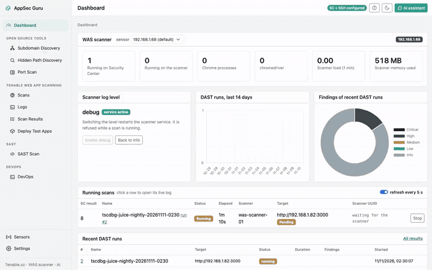

A full-quality tour is in [`docs/demo.mp4`](docs/demo.mp4).

### Screenshots

| | |
| --- | --- |
| **Dashboard** — live scans, per-sensor scanner widgets, findings | 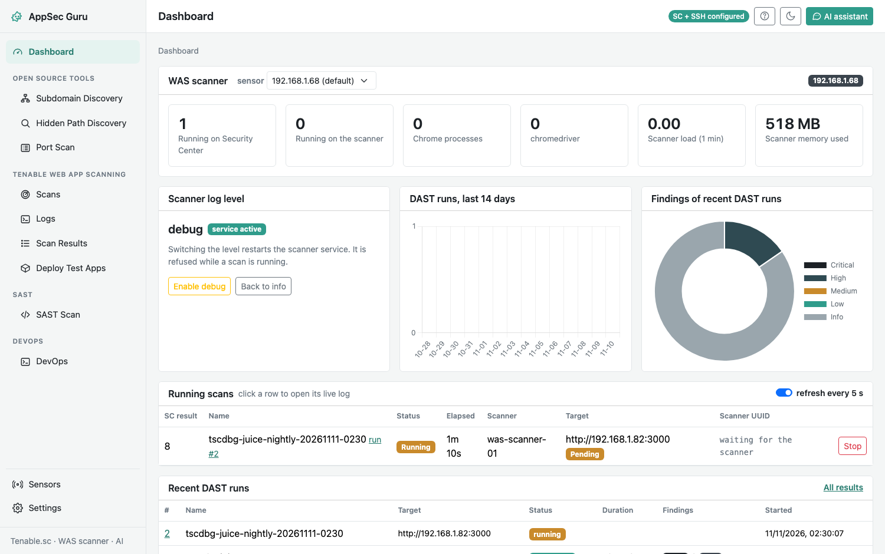 |
| **Create Scan** — a guided wizard with built-in test apps | 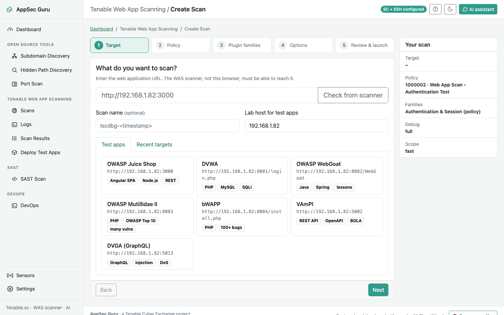 |
| **Scan Results** — offensive AI analysis and HTML report | 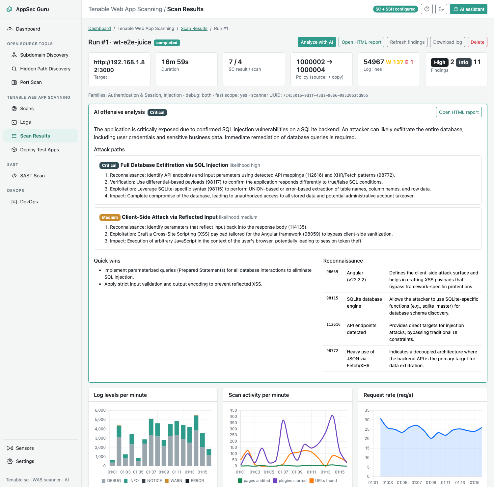 |
| **Live Logs** — the scanner log, filtered to one scan | 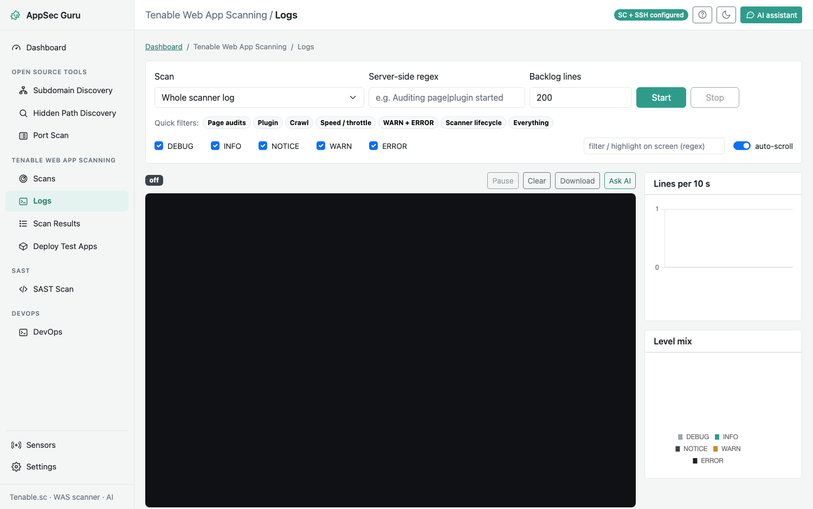 |
| **Subdomain Discovery** — subfinder → dnsx → httpx | 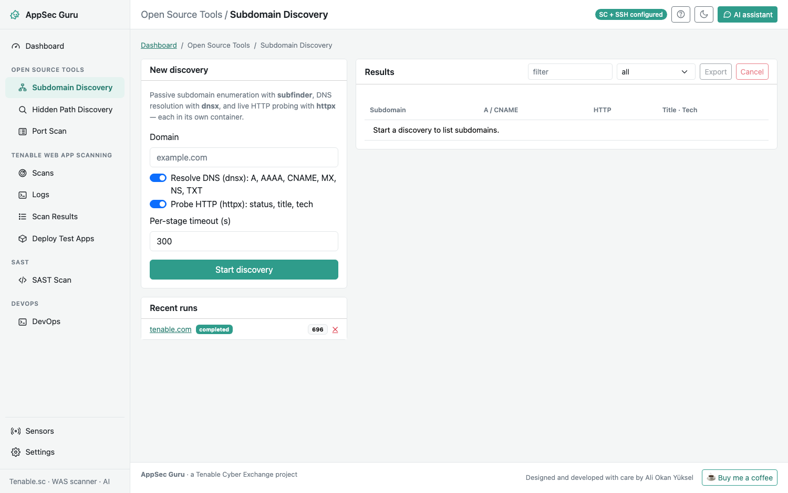 |
| **Hidden Path Discovery** — ffuf content discovery | 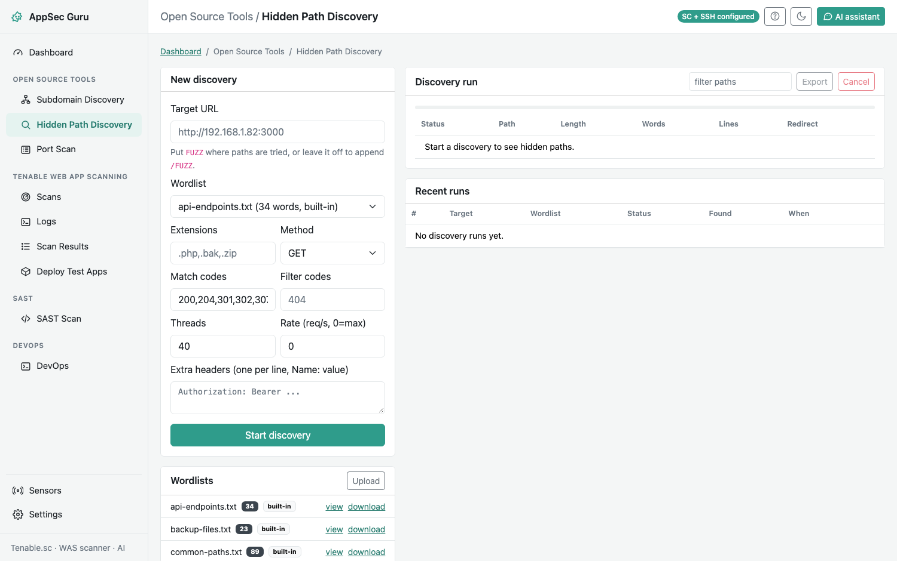 |
| **Port Scan** — RustScan | 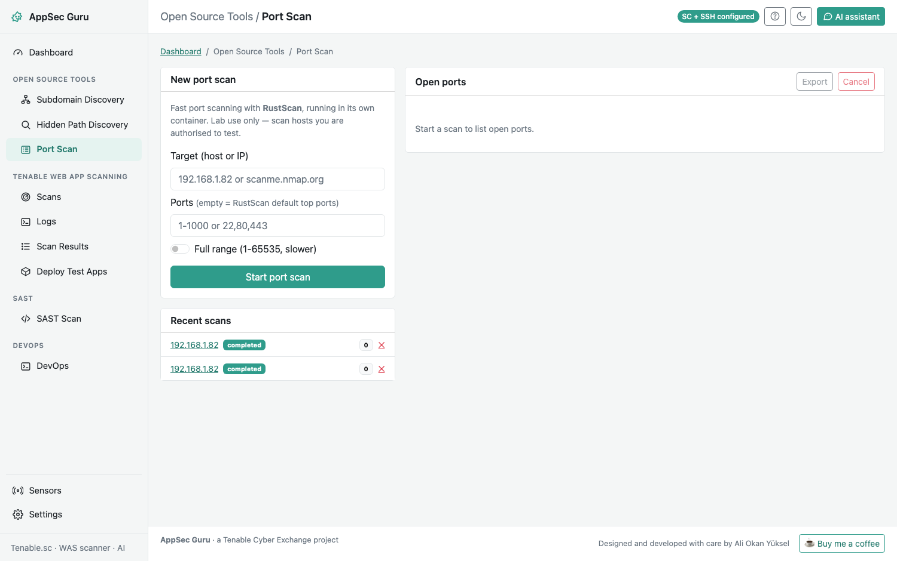 |
| **SAST Scan** — agentic source review | 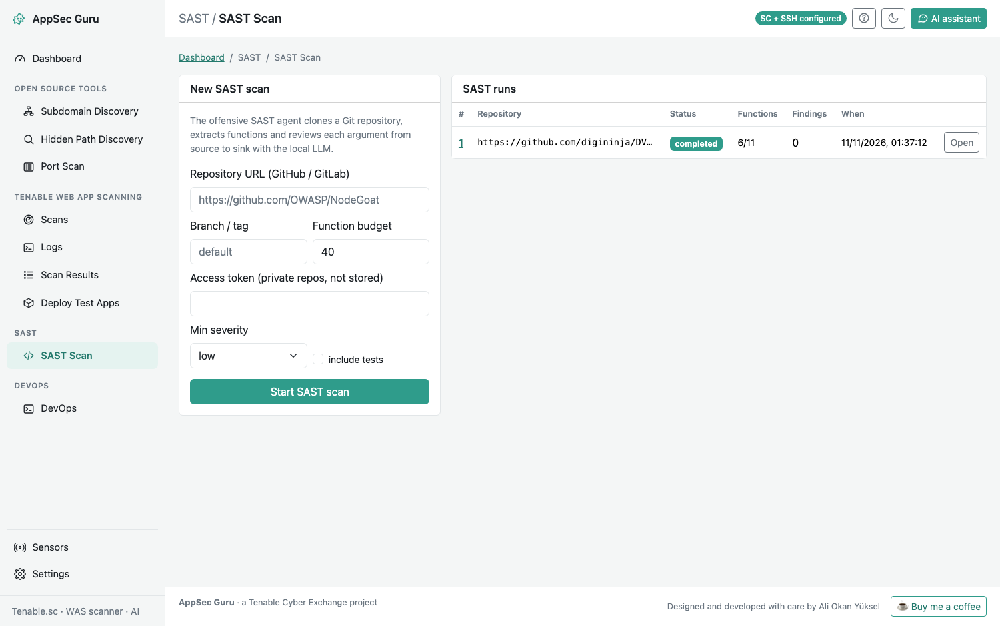 |
| **Scans** — saved scan profiles with schedules | 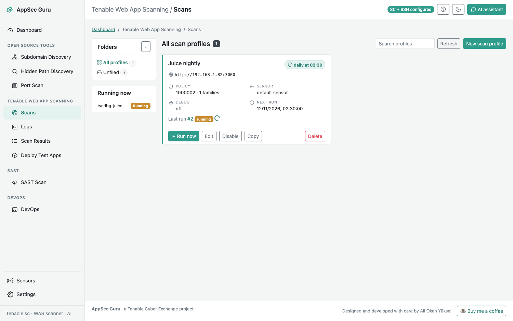 |
| **Sensors** — one Security Center, many WAS scanners | 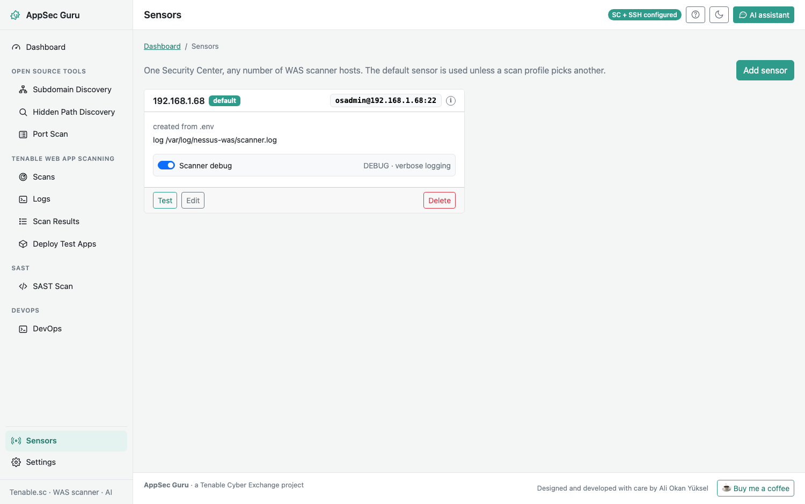 |

## What it does

| Area | Feature |
| --- | --- |
| **Dashboard** | Live view of scans running on Security Center and on each sensor, scanner load, log level, recent runs and findings. |
| **Hidden Path Discovery** | `ffuf`-based content discovery with built-in and uploadable wordlists. |
| **Scans** | Saved **scan profiles** in a folder tree, each with a target, policy, plugin families, sensor and a **schedule** (on-demand, once, interval, daily, weekly). A background scheduler runs them. |
| **Create Scan** | A step-by-step wizard: pick a target (or a built-in test app), compare policies, choose plugin families, set options, review and launch. |
| **Logs** | Live scanner-log stream (SSE) filtered to one scan, with level toggles, quick filters and per-10s charts. |
| **Scan Results** | Per-run detail: findings, captured log, activity charts, and the **offensive AI analysis** (attack paths, categories, reconnaissance from informational plugins, quick wins) rendered as a downloadable HTML report. |
| **Deploy Test Apps** | Ready `docker-compose.yml` snippets for OWASP Juice Shop, DVWA, WebGoat, Mutillidae, bWAPP, VAmPI and DVGA. |
| **SAST Scan** | An agentic harness clones a Git repo, extracts functions, and the offensive-security agent reviews each argument from source to sink with the local LLM. |
| **DevOps** | Copy-paste `curl` and CLI recipes for the whole REST API. |
| **Sensors** | One Security Center, many WAS scanner hosts; each a reusable ssh profile. |
| **AI assistant** | A chat (Ollama) on every page; attach on-screen logs, errors or scan status and ask. |

## Architecture

```
browser ── nginx ──┬── php-fpm (Twig pages in wwwroot/)
                   └── FastAPI (api/) ──┬── PostgreSQL (data, bind-mounted)
                                        ├── Tenable.sc REST API
                                        ├── ssh to each WAS sensor (logs, debug, processes)
                                        ├── ffuf (Hidden Path Discovery)
                                        └── Ollama (AI chat, findings analysis, SAST agent)
```

- **Services** (`docker-compose.yml`): `postgres`, `migrate` (Alembic), `api`, `php`, `web`.
- **No data in containers:** PostgreSQL, logs and wordlists are host bind mounts.
- **Bind-mounted code:** `api/`, `wwwroot/` and `ai/` are mounted read-only; a change needs only `docker compose restart api` (Python) or nothing (PHP/JS).
- **Agentic harness** in `ai/` (`agents/`, `skills/`, `tools/`) is read at run time; edit a Markdown file and the next run uses it.

## First run

```sh
cp .env.example .env            # set pg_password, sc_url + API keys, was_ssh_host, ollama_url
mkdir -p secrets
openssl rand -hex 32 > secrets/app_secret_key && chmod 600 secrets/app_secret_key
docker compose up -d --build
```

Open `http://127.0.0.1:8091` (set `web_bind=0.0.0.0` to reach it on the LAN).
Everything in **Settings** and **Sensors** can also come from `.env`; the UI overrides it.

### Configuration

`.env` holds the connection details (never committed; `.env.example` is the template):
Security Center URL + API keys, each WAS sensor's ssh host/credentials, the Ollama URL
and model, and PostgreSQL. Secrets saved from the UI are encrypted with `secrets/app_secret_key`.

## Day to day

```sh
docker compose restart api                 # after an api/ code change
docker compose logs -f api                 # api log (scheduler, runs, SAST)
docker compose exec postgres psql -U was_troubleshooter -d was_troubleshooter
docker compose down                        # stop (data stays on the host)
```

## The single-file CLI tools

`../tsc-was-debug-scanctl.py` and `../tsc-was-scanmon.py` (Python 3.6, standard library
only) do the same scan + debug-log work from a terminal on the Security Center host.
See the **DevOps** page for recipes and `../was-notes.html` for the full guide.

## Security

- The UI has no login; publish it on `127.0.0.1` or behind your own gateway.
- It connects to real scanners and starts real scans — point it at systems you are authorised to test.
- The test apps under **Deploy Test Apps** are intentionally vulnerable; run them on an isolated lab host only.
